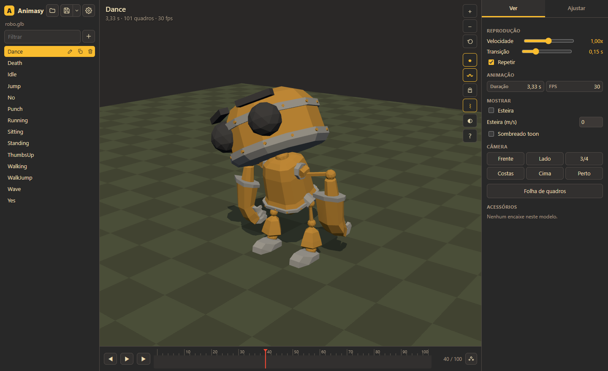
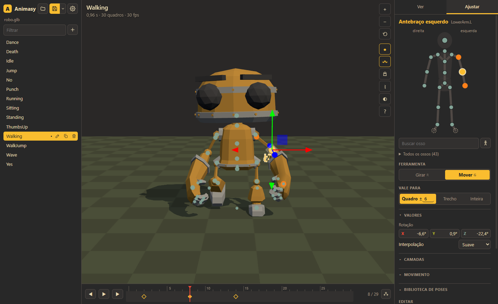
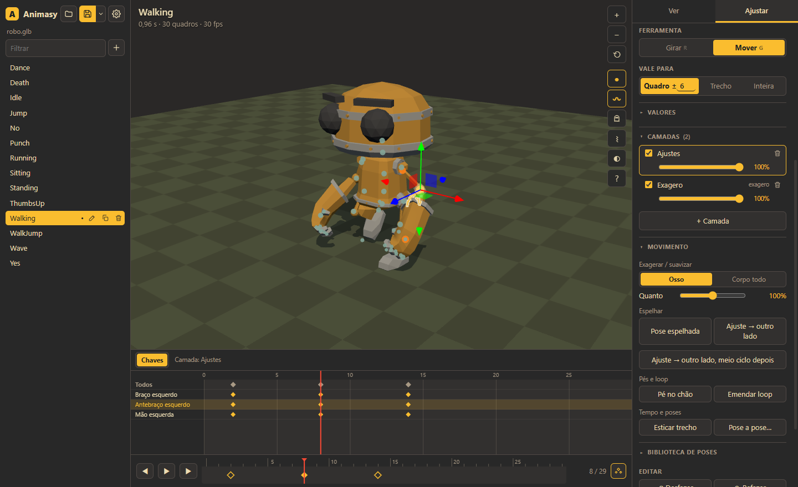
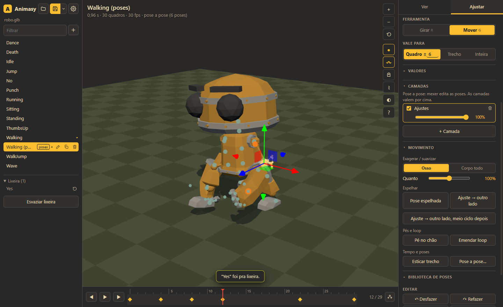
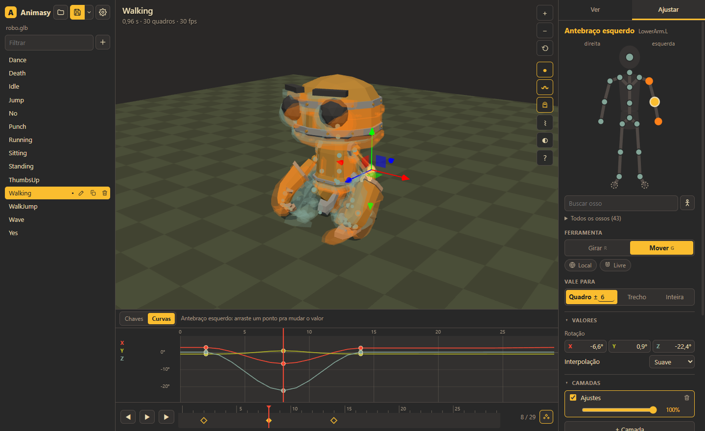
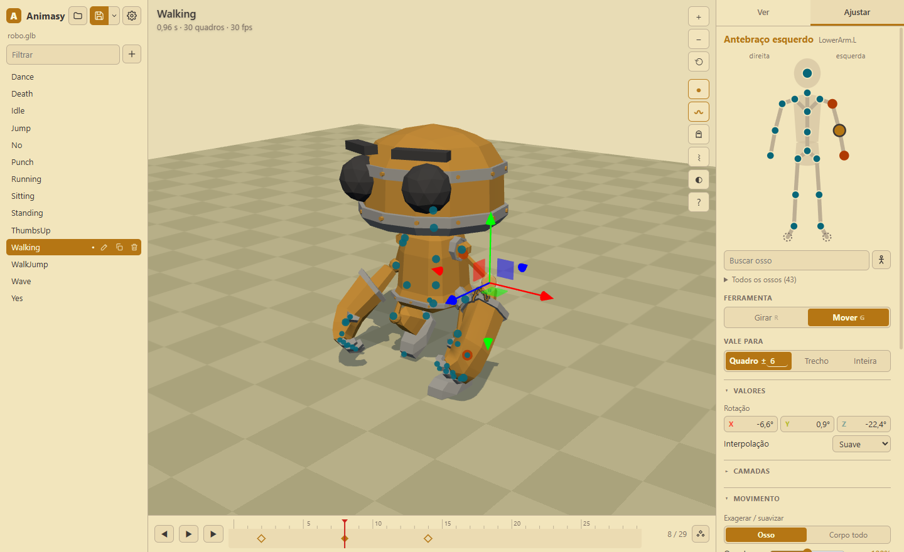

# Animasy

**Ver e ajustar animações de personagens 3D, direto no navegador.** Fácil, mas sem teto.

Abra um personagem riggado (glb, gltf, vrm ou fbx), veja cada animação com calma e corrija poses por cima,
sem estragar o original. Salva um `.glb` que serve em qualquer engine. Não precisa de Blender nem de servidor.



> **English summary:** Animasy is a free, static web app (MIT) to view and fix animations of any rigged 3D character
> (glb, gltf, vrm, fbx) in the browser. Non-destructive adjustment layers, scope "frame / range / whole clip", move-joint
> IK, mirror, foot lock, loop seam, pose-to-pose, pose library, accessories on sockets, one-at-a-time retarget with
> preview, and a verified `.glb` export (re-read and compared frame by frame before writing). No server, no Blender.
> Run `npm install && npm run build` and open `dist/index.html`, or double-click `abrir.bat` on Windows. UI and docs are in Portuguese (pt-BR).

## Como abrir

- **Windows:** dois cliques no `abrir.bat` (na primeira vez ele instala e prepara tudo; precisa do [Node.js](https://nodejs.org)).
- **Qualquer sistema:** `npm install`, `npm run build` e abra `dist/index.html` no Chrome ou no Edge.
  O build é um arquivo só, então dá pra copiar o `index.html` pra onde quiser.

Depois é só arrastar o modelo pra janela, ou clicar em **Ver exemplo**.

## Ajustar, do jeito simples

1. Aba **Ajustar**. Clique numa junta do **boneco** (direita do personagem fica à esquerda da tela) ou direto no corpo.
   Pra ossos que não são de gente (dedos, rabo, orelha), use **Buscar osso** ou **Todos os ossos**.
2. **Girar** (R) gira o osso. **Mover** (G) leva a junta pro lugar novo, e o corpo acompanha:
   - mão/pé: o braço/perna dobra junto (IK);
   - cotovelo/joelho: gira em volta da linha ombro→mão, com a mão parada;
   - quadril: o corpo todo anda;
   - barriga, peito, pescoço: a coluna curva, dividida entre as vértebras;
   - o resto (cabeça, ombro, dedos…): o osso de cima gira.
3. **Vale para** escolhe até onde o ajuste vai:
   - **Quadro ±6**: só em volta deste quadro, entrando e saindo suave;
   - **Trecho**: no pedaço marcado na régua (arraste na faixa de cima da linha do tempo), com rampa nas pontas;
   - **Inteira**: na animação toda, de uma vez. Ex.: "braço mais aberto no andar inteiro" é um ajuste só.
4. **Valores** mostra a rotação (e a posição, quando o osso tem) em números: arraste em cima da letra ou digite.
   **Interpolação** muda a chave deste quadro: suave, linear, constante, ease in ou ease out.



## Ferramentas pra não mexer quadro a quadro

- **Camadas:** cada ajuste pode ficar numa camada com peso (0 a 100%) e liga/desliga. Bom pra comparar.
- **Exagerar / suavizar:** "braço balançando mais", "menos quique". Multiplica o movimento em volta da pose média,
  num osso ou no corpo todo. É uma camada, então dá pra desligar.
- **Espelhar:** a pose deste quadro com esquerda e direita trocadas (M), ou o ajuste de um osso copiado pro outro
  lado. No andar/corrida, **meio ciclo depois**: corrigiu o braço esquerdo, o direito ganha a mesma correção na hora
  certa do passo.
- **Pé no chão:** prende o pé na pisada em volta do quadro (ou no trecho marcado). Desconta a esteira, então serve
  pra andar no lugar. Avisa quando a perna não alcança.
- **Emendar loop:** tira o pulo entre o último e o primeiro quadro.
- **Esticar trecho** e **Duração** (aba Ver): deixa um pedaço, ou a animação toda, mais lento ou mais rápido.
- **Pose a pose:** cria uma cópia só com as poses-chave (o Animasy acha os extremos do movimento). Mexeu numa pose,
  o movimento até as vizinhas acompanha. Mexer num quadro sem pose cria uma pose ali; Delete tira.
- **Biblioteca de poses:** guarde a pose de um quadro e aplique em outra animação.





## Pra quem quer mais (modo avançado, nas Configurações)

- **Painel de chaves** (K): uma linha por osso; arraste uma chave no tempo. No modo avançado, **Curvas**: as
  rotações X/Y/Z do osso em graus; arraste um ponto pra mudar o valor.
- **Fantasmas** (O): os quadros vizinhos transparentes, com a animação parada.
- Eixos do gizmo (local/mundo) e passo do encaixe (de 5 em 5°, de 1 em 1 cm…).



## Acessórios

Ao abrir um modelo com pontos de encaixe (nós como `Socket_Sword`, ou nós vazios presos num osso), aparece um aviso:
"Achei 2 encaixes… Quer colocar um acessório?". Em **Ver › Acessórios** você escolhe um `.glb` pra cada encaixe
(ou arrasta o arquivo em cima do encaixe) e ajusta posição/rotação com o gizmo ou números (graus na ordem YXZ, a
mesma da Godot). O projeto lembra o arquivo e o encaixe. Por padrão o acessório é **só pra ver**; marque
**vai no arquivo** pra ele sair junto no `.glb`.

## Também

- **Mapa do corpo automático:** reconhece os nomes de ossos do Mixamo, Rigify, Unreal, VRM e do Blender.
  O que não reconhecer, você associa uma vez e fica guardado.
- **Gerenciar animações:** criar (da pose de repouso, da pose atual ou cópia), renomear, duplicar.
  **Excluir manda pra lixeira**, com confirmação, e dá pra restaurar.
- **Salvar com conferência:** antes de gravar, o Animasy reabre o arquivo gerado e compara osso por osso, quadro a
  quadro, com o que está na tela (camadas, exagero e tudo). Se não bater, não grava. Salvar por cima guarda a versão
  anterior (menu ▾ › Desfazer último salvamento).
- **Nada se perde:** ajustes, animações novas, lixeira, poses guardadas e acessórios ficam guardados no navegador.
  Fechou sem salvar? Abra de novo e clique em **Continuar**. Nada vai pra internet.
- **Temas:** Gruvbox escuro (padrão), Gruvbox claro e o azul original, nas Configurações (⚙).



Atalhos e dicas ficam no botão **?**.

## Projeto com Blender (opcional)

Se o original das animações é um `.blend`, o `.glb` salvo pelo Animasy seria sobrescrito no próximo export do Blender.
Pra trazer o ajuste de volta, rode no Blender (com o `.blend` **fechado** no programa) um script que copia as
animações mudadas pra dentro do `.blend`, reexporta o `.glb` e faz backup antes. Exemplo do projeto do Linque:

```
blender -b linque.blend --factory-startup --python lq_importar_glb.py -- ARQUIVO_DO_ANIMASY.glb Guard GuardWalk
```

Sem nomes no fim, ele traz toda animação que difere da do `.blend` (ruído de até 0,1° é ignorado). O Animasy em si
não chama o Blender: o fluxo é salvar aqui e rodar o comando.

## Trazer animação de outro personagem

Botão **Trazer de outro modelo…** (aba Ver). Escolha o arquivo e **uma** animação; o Animasy converte pela orientação
dos ossos (mapa do corpo dos dois modelos) e pela altura do quadril, e mostra a prévia: o personagem de origem num
quadradinho no canto, o seu com a animação nova. Só entra na lista se você clicar em **Aceitar**. Funciona melhor
com proporções e pose de repouso parecidas (os dois em T, ou os dois em A): a conta leva a *variação* do osso, não a pose
absoluta. Primeiro passe: quando os repousos diferem (ex.: robô em T, personagem em A) os braços saem mais abertos que o
original; aceite e corrija com o Ajustar, ou descarte.

## Para quem programa

```
src/nucleo/      sem interface: camadas (ajuste/exagero, peso), chaves e interpolação, escopos, IK e "mover junta",
                 espelho, pose a pose, esticar tempo, encaixes, mapa do corpo, assar e conferir
src/arquivos/    abrir (glb/gltf/vrm/fbx), salvar (GLTFExporter + File System Access API), projeto (IndexedDB)
src/interface/   linha do tempo, painel de chaves/curvas, silhueta, árvore de ossos, campos de número, tema, diálogos
src/main.ts      cena (three.js) e a ligação de tudo
tests/           testes do núcleo (npm test)
```

`npm run dev` sobe a versão de desenvolvimento. No console do navegador, `window.animasy` expõe funções pra testes
automáticos (abrir, ajustar, mover junta, espelhar, exportar e conferir).

## Créditos e licença

- Código: [MIT](LICENSE).
- Modelo de exemplo (`src/exemplos/robo.glb`): **RobotExpressive**, de Tomás Laulhé
  ([Quaternius](https://quaternius.com)), modificações de Don McCurdy. **CC0 1.0** (domínio público).
  Tirado dos exemplos do [three.js](https://github.com/mrdoob/three.js/tree/r170/examples/models/gltf/RobotExpressive).
  Os braços dele têm tamanhos diferentes (65,7 e 57,5 cm), então a pose espelhada bate na orientação dos ossos,
  mas não na posição das mãos.
- Tema baseado na paleta [Gruvbox](https://github.com/morhetz/gruvbox) (MIT).
- Feito com [three.js](https://threejs.org) (MIT) e [Vite](https://vitejs.dev) (MIT).
