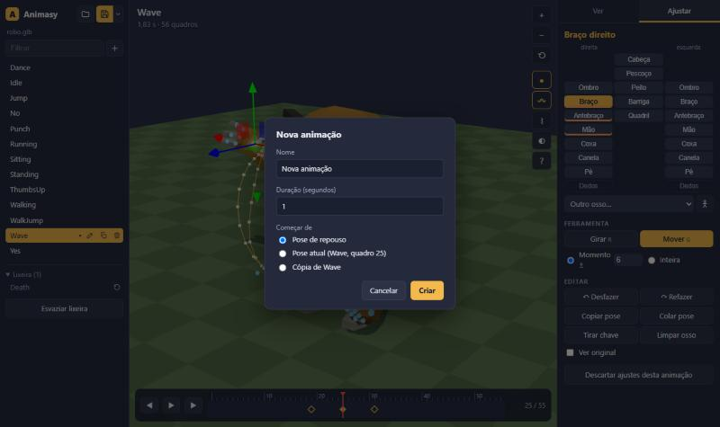

# Animasy

**Ver e ajustar animações de personagens 3D, direto no navegador.** Fácil, mas sem teto.

Abra um personagem riggado (glb, gltf, vrm ou fbx), veja cada animação com calma e corrija poses por cima,
sem estragar o original. Salva um `.glb` que serve em qualquer engine. Não precisa de Blender nem de servidor.


## Como abrir

- **Windows:** dois cliques no `abrir.bat` (na primeira vez ele instala e prepara tudo; precisa do [Node.js](https://nodejs.org)).
- **Qualquer sistema:** `npm install`, `npm run build` e abra `dist/index.html` no Chrome ou no Edge.
  O build é um arquivo só, então dá pra copiar o `index.html` pra onde quiser.

Depois é só arrastar o modelo pra janela, ou clicar em **Ver exemplo**.

## O que dá pra fazer

- **Ver:** lista de animações, velocidade, transição entre clipes, trecho em loop (arraste na régua), esteira
  (chão andando, pra ver pé deslizando), rastro do movimento, folha de quadros, câmeras prontas.
- **Ajustar:** clique numa junta (ou direto no corpo) e gire, ou **mova** a mão/pé (o braço/perna acompanha com IK)
  e o quadril. O ajuste vale num **momento** (entra e sai suave) ou na animação **inteira**. Chaves arrastáveis na
  linha do tempo, copiar/colar pose, desfazer/refazer, "ver original".
- **Mapa do corpo automático:** reconhece os nomes de ossos do Mixamo, Rigify, Unreal, VRM e do Blender.
  O que não reconhecer, você associa uma vez e fica guardado.
- **Gerenciar animações:** criar (da pose de repouso, da pose atual ou cópia), renomear, duplicar.
  **Excluir manda pra lixeira**, com confirmação, e dá pra restaurar.
- **Salvar com conferência:** antes de gravar, o Animasy reabre o arquivo gerado e compara osso por osso, quadro a
  quadro, com o que está na tela. Se não bater, não grava. Salvar por cima guarda a versão anterior
  (menu ▾ › Desfazer último salvamento).
- **Nada se perde:** ajustes, animações novas e a lixeira ficam guardados no navegador. Fechou sem salvar?
  Abra de novo e clique em **Continuar**. Nada vai pra internet.




Atalhos e dicas ficam no botão **?**.

## Para quem programa

```
src/nucleo/      camada de ajuste, IK de 2 ossos, mapa do corpo, "assar" ajustes no clipe (sem interface)
src/arquivos/    abrir (glb/gltf/vrm/fbx), salvar (GLTFExporter + File System Access API), projeto (IndexedDB)
src/interface/   linha do tempo, diálogos, ícones
src/main.ts      cena (three.js) e a ligação de tudo
tests/           testes do núcleo (npm test)
```

`npm run dev` sobe a versão de desenvolvimento. No console do navegador, `window.animasy` expõe funções pra testes
automáticos (abrir, ajustar, exportar e conferir).

## Créditos e licença

- Código: [MIT](LICENSE).
- Modelo de exemplo (`src/exemplos/robo.glb`): **RobotExpressive**, de Tomás Laulhé
  ([Quaternius](https://quaternius.com)), modificações de Don McCurdy. **CC0 1.0** (domínio público).
  Tirado dos exemplos do [three.js](https://github.com/mrdoob/three.js/tree/r170/examples/models/gltf/RobotExpressive).
- Feito com [three.js](https://threejs.org) (MIT) e [Vite](https://vitejs.dev) (MIT).
